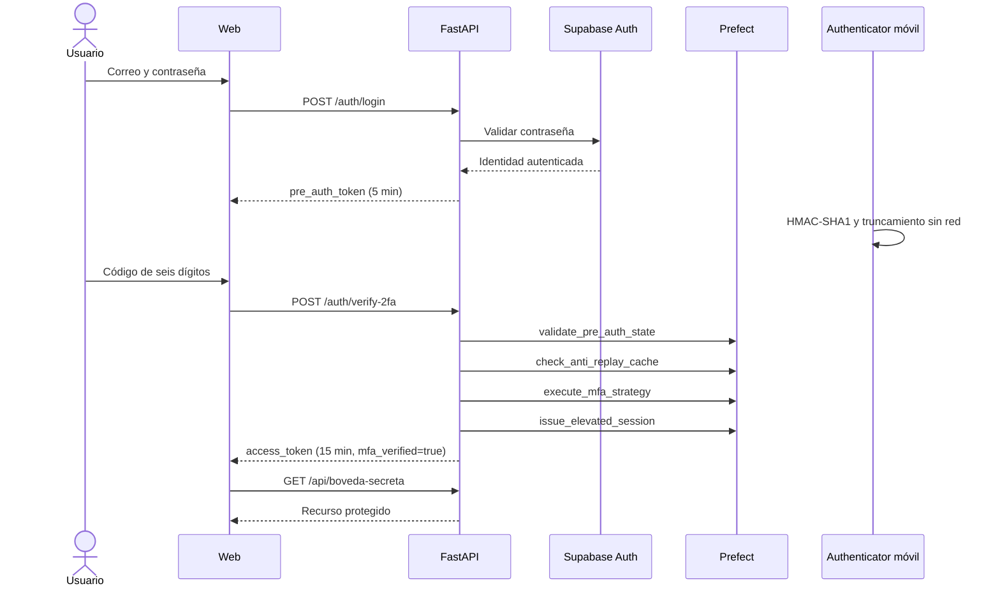

# Arquitectura

## Aprovisionamiento

`POST /auth/enroll/start` verifica la contraseña por separado y crea una semilla aleatoria de 160 bits en estado pendiente. Devuelve un token de propósito `enrollment`, Base32 y URI/QR. El token `pre_auth` nunca autoriza aprovisionamiento: solo verifica el segundo factor. `POST /auth/enroll/confirm` exige el token de aprovisionamiento y el primer TOTP. Tras validarlo, activa el factor y genera ocho códigos de respaldo de 64 bits cada uno. Una contraseña por sí sola no permite sustituir un factor activo.

El proceso pendiente expira en cinco minutos y puede reiniciarse mientras no esté activo. La confirmación consume el código TOTP, por eso el primer login requiere esperar a otro código o usar respaldo. Si se pierde el teléfono, los respaldos permiten ingresar, pero la PoC no incluye una interfaz para reconfigurar MFA; no borres la base para “recuperar” una cuenta real.

## Criptografía

`C = floor(UnixTime / 30)` se codifica en ocho bytes big-endian. HMAC-SHA1 produce 20 bytes. Los cuatro bits bajos del último byte determinan el desplazamiento de cuatro bytes; se elimina el bit de signo, se aplica módulo 1 000 000 y se rellena con ceros. `@noble/hashes` proporciona únicamente SHA1/HMAC; Base32, contador y truncamiento son propios. Python usa `hmac`, `hashlib` y `struct` estándar.

## Persistencia y concurrencia

Supabase Auth almacena usuarios. El backend no expone su sesión al navegador. SQLite almacena semillas cifradas con Fernet, respaldos como HMAC-SHA256 y códigos consumidos como HMAC-SHA256, con clave privada local. No se guardan códigos en claro. `used_codes` expira a los 90 segundos; los respaldos se eliminan definitivamente al consumirlos.

Un `Lock` por servicio serializa el pipeline completo. Así, de dos verificaciones simultáneas, la primera consume el código y la segunda falla en la tarea anti-replay. Los cambios finales usan una transacción SQLite. Es un diseño de un único proceso; escalar exige trasladar el bloqueo y el consumo atómico a un sistema compartido. No basta con añadir workers.

## Observabilidad sin credenciales

Los parámetros de los flows y tasks contienen solo un identificador aleatorio. Un registro transitorio en memoria contiene los datos de solicitud y se limpia con `finally`. Las tareas no retornan secretos, no persisten resultados, no aplican caché y no tienen reintentos. El flujo de verificación se detiene ante el primer error. Los logs de estrategia muestran C−1/C/C+1 o respaldo, sin imprimir el código.

Esta elección liga los flows al proceso FastAPI: no se pueden ejecutar como tareas remotas o reiniciar desde el dashboard usando solo el identificador. Reintenta desde el cliente con una nueva solicitud.

## Límites

La aplicación se sirve en localhost para el laboratorio. Los tokens no son sesiones Supabase, no afirman `aal2` ni protegen tablas externas. El cierre local borra el estado del navegador; no revoca un JWT ya emitido. Las claves locales deben conservarse: cambiarlas invalida tokens o impide descifrar semillas. No hay sincronización de semillas con la nube, recuperación administrativa, auditoría de producción ni protección distribuida contra abuso.
