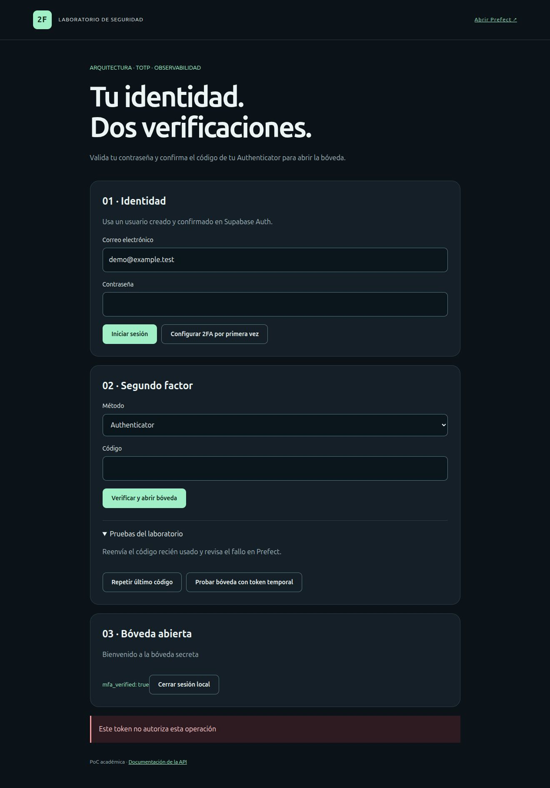

# Verificación de la entrega

Fecha: 24 de octubre de 2026.

| Comprobación | Resultado observado |
| --- | --- |
| Pytest con servidor Prefect temporal real | 27 pruebas aprobadas |
| TOTP JavaScript con Node 24 | 10 pruebas aprobadas |
| Lint y comprobación de tipos | Ambos finalizan sin errores |
| Expo export Android | Bundle generado correctamente |
| Expo export web | Bundle generado correctamente |
| Supabase Auth configurado | `/auth/v1/settings` responde 200; proveedor email habilitado |
| Web contra Supabase real | Formulario visible; credenciales ficticias rechazadas con mensaje controlado |
| Recorrido en navegador con identidad ficticia aislada | TOTP generado por la app abre bóveda; replay rechazado; token temporal denegado |
| Cuenta real y teléfono Android | Pendiente de verificación manual con el usuario |
| Video de sustentación | Guion preparado; grabación pendiente |

Las pruebas positivas automatizadas usan una identidad de prueba, no una cuenta Supabase real. Se ejecuta Prefect real para comprobar el estado de tareas y flows. La conectividad de Supabase y el rechazo de credenciales inválidas se comprobaron contra el proyecto elegido. No se presenta la compilación de Expo como prueba de modo avión.

## Dependencias

`npm audit` reporta cinco alertas altas en la cadena de herramientas Expo: Expo, su CLI, certificados de firma, `node-forge` y `zod`. Son dos avisos raíz propagados a sus dependientes. A la fecha consultada, `node-forge` 1.4.0 sigue siendo la última versión publicada y está incluida en el rango afectado. El CLI utiliza Zod 3.25.76; la versión corregida reportada es de la rama 4, por lo que no se fuerza un cambio mayor incompatible. La propuesta automática de npm de bajar Expo a SDK 44 no se aplica.

Los avisos están en herramientas de desarrollo, no en el algoritmo HMAC/TOTP propio; requieren seguimiento y actualización compatible antes de ampliar el uso del proyecto. No se afirma que el árbol de dependencias esté libre de vulnerabilidades.

- [Aviso de node-forge](https://github.com/advisories/GHSA-86w9-cpqp-85rv)
- [Aviso de Zod](https://github.com/advisories/GHSA-mrhx-c7xc-m3w5)

Los lockfiles registran las versiones instaladas para reproducir los resultados. La suite Python emite una advertencia de deprecación de Starlette sobre TestClient/httpx; las pruebas terminan correctamente.
